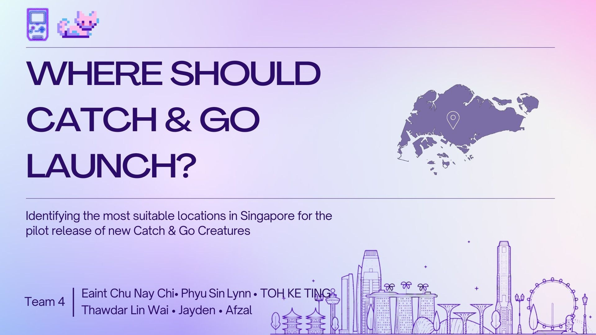
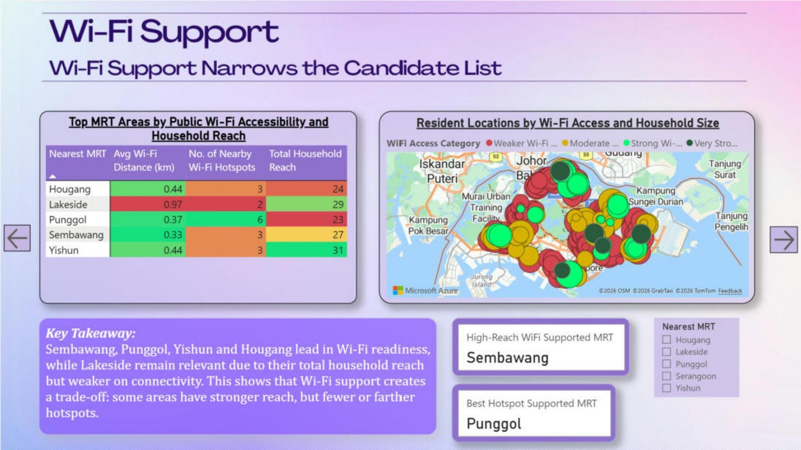
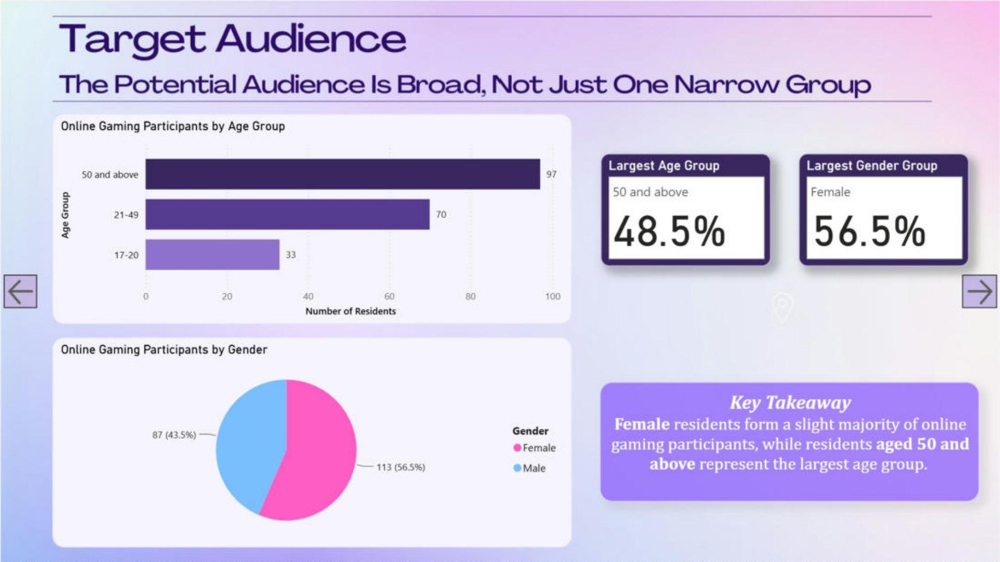
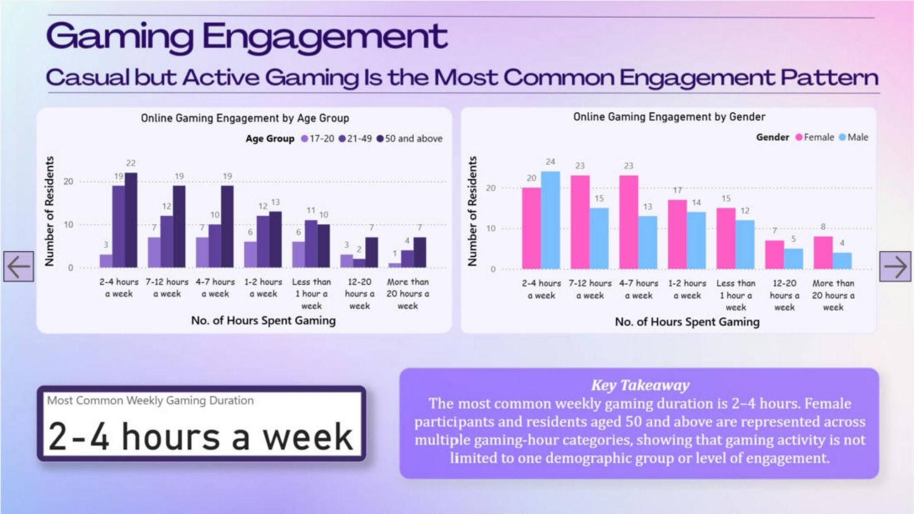
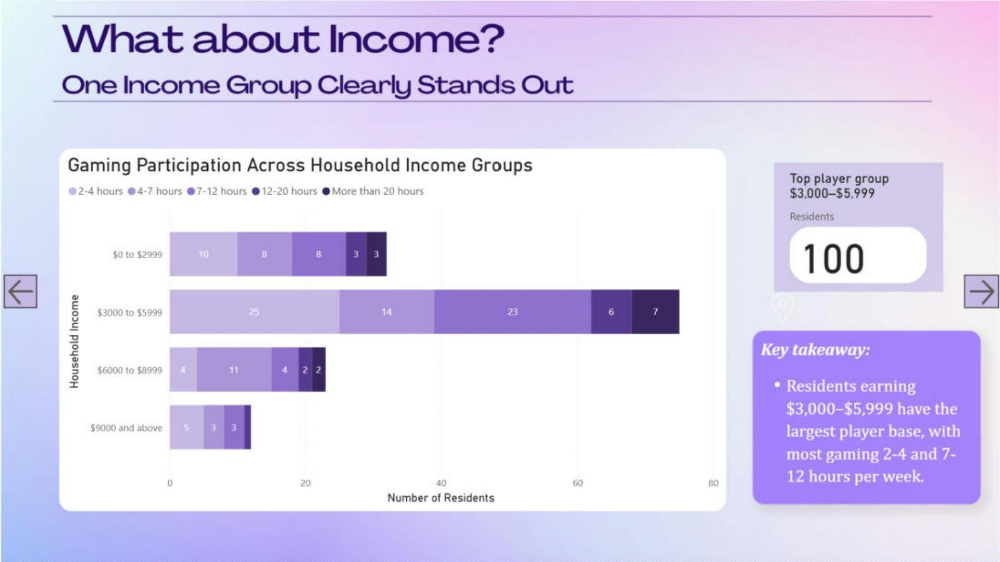
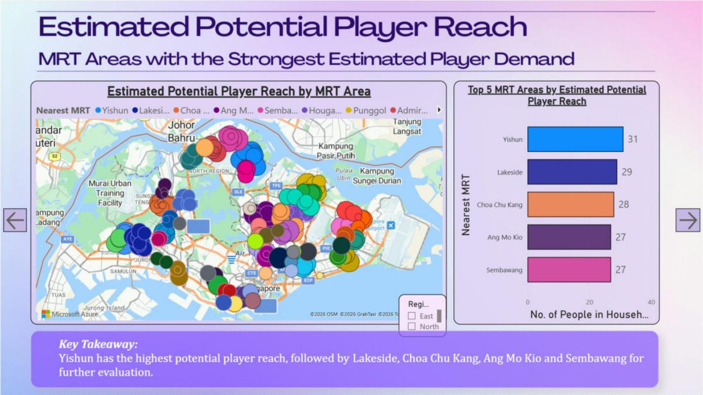
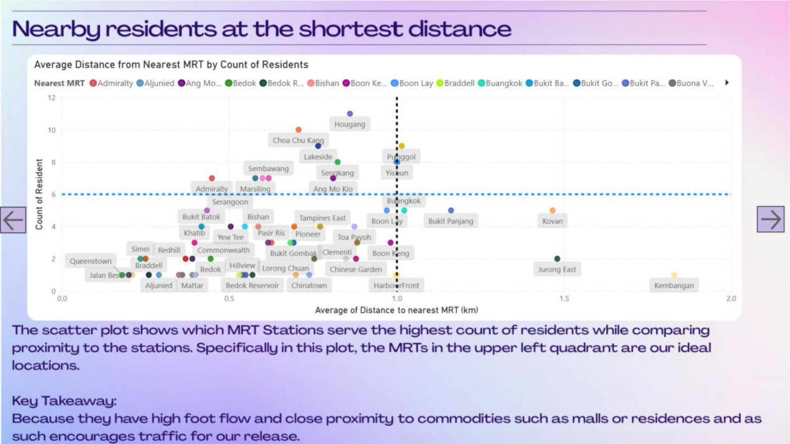
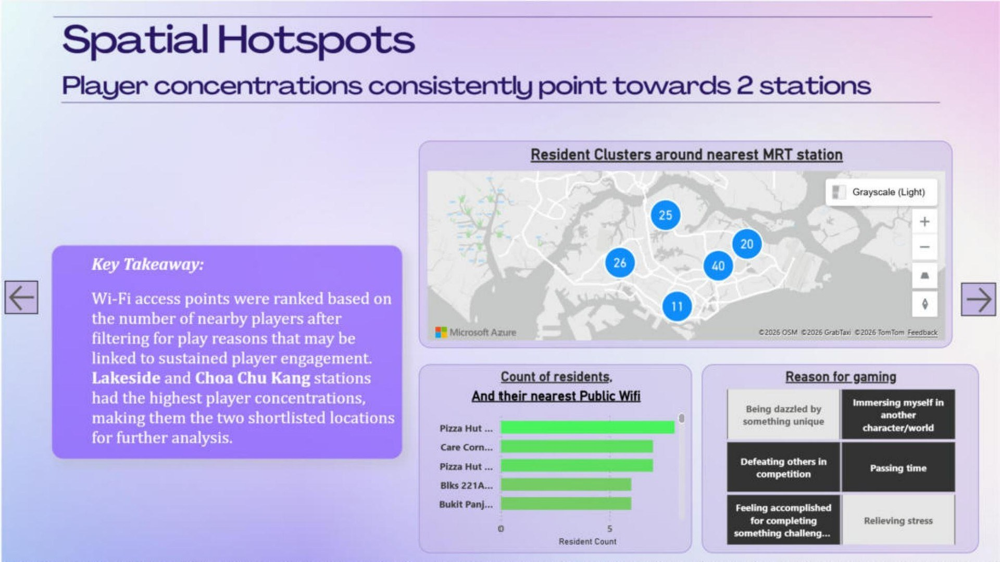
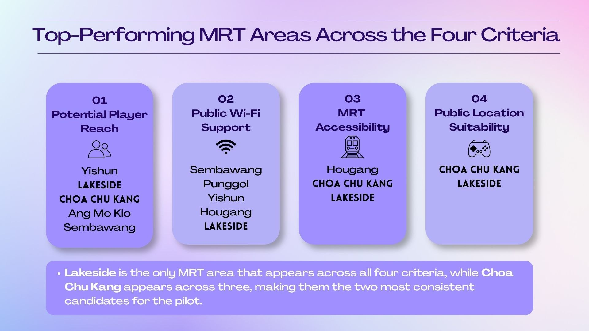
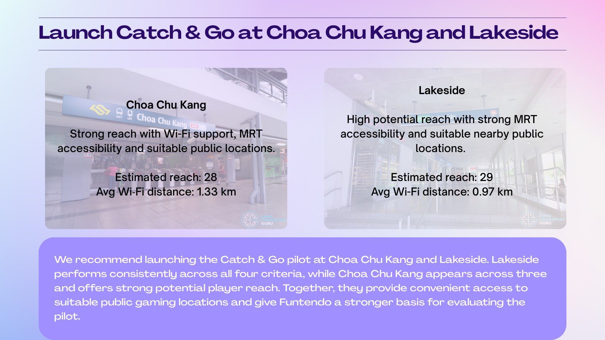

# Where Should Catch & Go Launch? — Power BI Location Analysis

> **Team project (Team 4).** My part: the **Wi-Fi Support** analysis (page 10 of the report).

A Power BI data story recommending where in Singapore the fictional game studio *Funtendo* should pilot new creatures for its AR mobile game, **Catch & Go**. It analyses 200 surveyed residents and compares MRT areas on four criteria. The recommendation is a **two-site pilot at Choa Chu Kang and Lakeside**.

  

📄 **[Read the full report (PDF, 17 pages)](Catch_and_Go_Report.pdf)**

## The question

A popular location isn't always the best pilot location. If players can't get there easily, or the Wi-Fi is poor, the pilot may not perform well. So each MRT area was judged on four criteria:

1. **Potential player reach:** which areas have the most potential players?
2. **Public Wi-Fi support:** are public hotspots nearby and close enough? *(my analysis)*
3. **MRT accessibility:** do many surveyed residents live close to the station?
4. **Public location suitability:** are player clusters near public venues suitable for AR gameplay?

## My part: Wi-Fi Support

  

- **Table:** ranks the top MRT areas by average distance to public Wi-Fi, number of nearby hotspots and total household reach, with colour scales to show trade-offs at a glance.
- **Map:** plots resident locations by Wi-Fi access category (weaker to very strong) and household size.
- **Cards:** show the highest-reach Wi-Fi-supported MRT area (**Sembawang**) and the best hotspot-supported area (**Punggol**).
- **Finding:** Sembawang, Punggol, Yishun and Hougang lead on Wi-Fi readiness. Lakeside stays in contention because of its household reach, despite weaker connectivity (0.97 km average distance, 2 hotspots). In other words, Wi-Fi support creates a trade-off between reach and connectivity.

## Result

| Criterion | Top MRT areas |
|---|---|
| Potential player reach | Yishun, **Lakeside**, **Choa Chu Kang**, Ang Mo Kio, Sembawang |
| Public Wi-Fi support | Sembawang, Punggol, Yishun, Hougang, **Lakeside** |
| MRT accessibility | Hougang, **Choa Chu Kang**, **Lakeside** |
| Public location suitability | **Choa Chu Kang**, **Lakeside** |

**Lakeside** is the only area that appears under all four criteria, and **Choa Chu Kang** appears under three. The recommendation is a controlled two-site pilot there, tracking turnout, repeat play and connection performance before scaling to similar MRT areas.

## Report pages

| | |
|---|---|
|  |  |
|  |  |
|  |  |
|  |  |

## Tools

Power BI (Azure Maps, conditional formatting, slicers, card visuals, page navigation buttons) · data storytelling · Canva for slide design

## Notes

- The resident dataset was provided for the coursework and isn't included here. The report pages show the analysis only.
- The station photos on the recommendation page carry Land Transport Guru's watermark.
- The PDF was made from screenshots of the Power BI report, because Power BI's built-in PDF export was blocked by the file's sensitivity label. Interactive features such as slicers and page buttons aren't shown in the PDF.

## Team 4

Eaint Chu Nay Chi ([Chu268](https://github.com/Chu268)) · **Phyu Sin Lynn (Emi)** — Wi-Fi Support analysis · Toh Ke Ting · Thawdar Lin Wai · Jayden · Afzal

*Completed as team coursework (CA3) at Singapore Polytechnic.*

[Emi's portfolio](https://emi-psl.github.io/portfolio/) · [GitHub](https://github.com/emi-psl) · [LinkedIn](https://www.linkedin.com/in/phyusinlynn)
